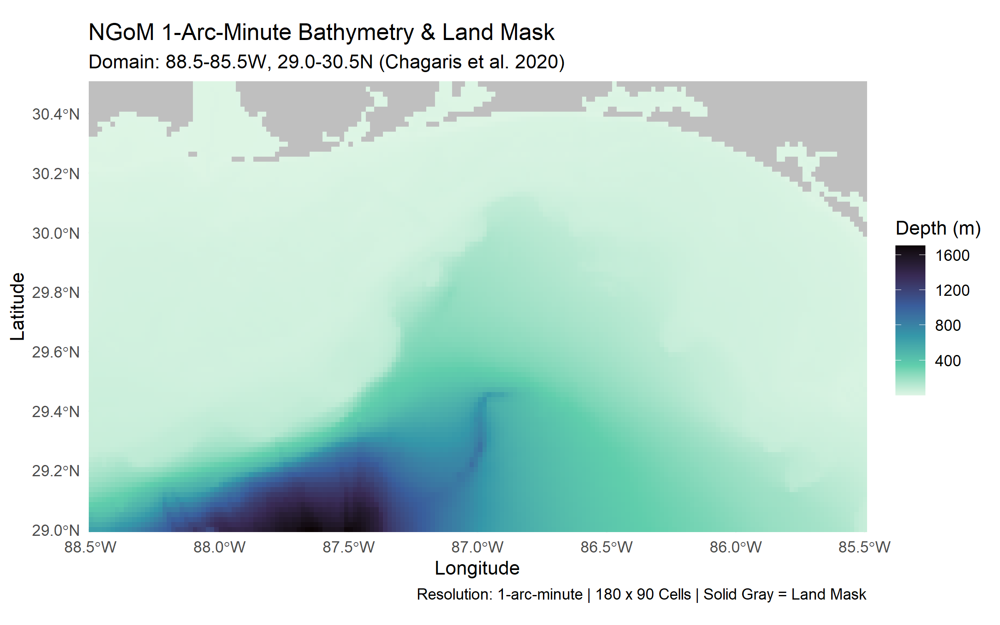

# OptimalEcospace
This repository houses the methodology to turn the Ecospace console into an optimization function. The code requires the following: 1) an Ecopsace model; 2) the Ecospace console app and associated code; and 3) manager preferences to constrain runs.

   
  <i><b>Figure 1.</b> Bathymetry map of the model domain at 1 arc-minute resolution.</i>

   
  <i><b>Figure 2.</b> Initial seabed types embedded in the model.</i>

## Live Solver
`R/LiveSolver` is an interactive app for exploring artificial-structure installation and decommissioning scenarios with Ecospace. You choose a model, adjust the constraints, run any number of scenarios, and compare the results in your web browser. To start it on Windows, double-click `Start Live Solver.bat`, or open `R/LiveSolver/launch.R` in RStudio and click **Source**. See [R/LiveSolver/README.md](R/LiveSolver/README.md) for details.
